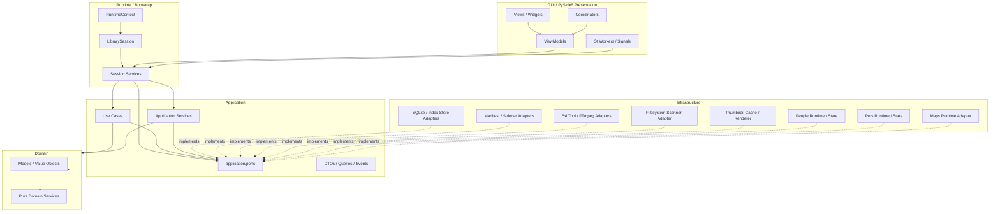
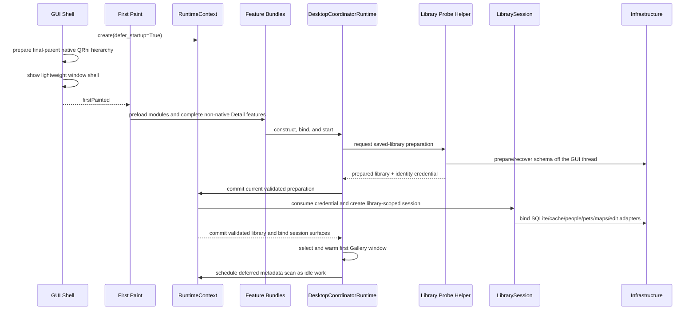
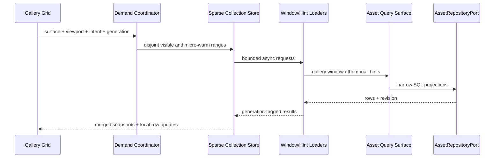
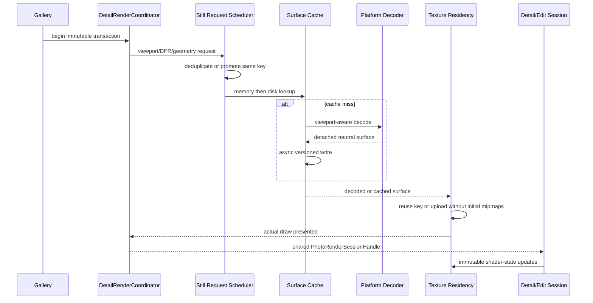
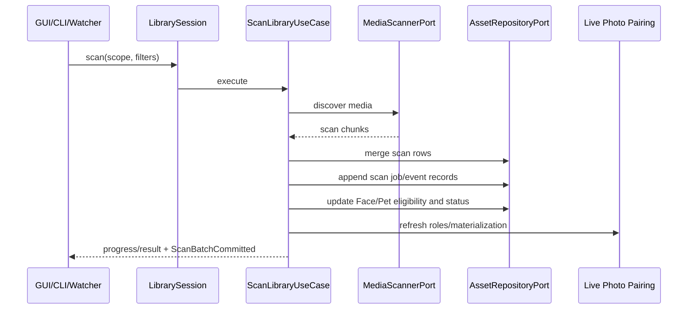
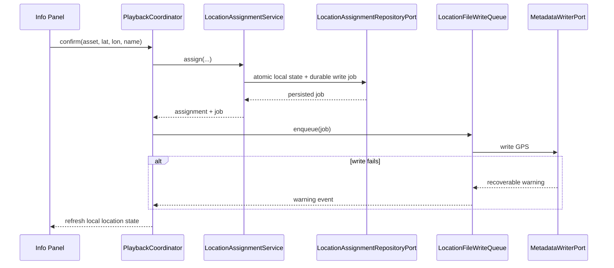
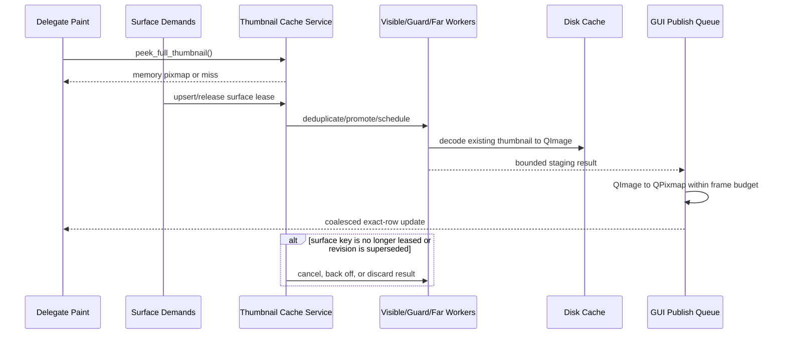

# Architecture

This document owns iPhotron's current cross-module runtime and persistence
contracts. The codebase is a library-scoped modular desktop monolith:
one process-level `RuntimeContext` owns one active `LibrarySession`, and GUI,
CLI, watchers, and workers enter behavior through application surfaces rather
than legacy facades.

Use the [development guide](development.md) for environment and routine commands,
and the linked `misc/` references for subsystem rules. Completed migration
records live in the [vNext archive](finished/refactor/vnext-2026-06/README.md).

## Status

The production entry path is `RuntimeContext -> LibrarySession`.

- Production runtime code no longer imports `iPhoto.legacy` or `iPhoto.models.*`.
- The compatibility application tree and old domain-repository implementation
  under `src/iPhoto/legacy/` have been removed.
- `RuntimeContext -> LibrarySession` is the active library entry path.
- Application ports and services define the boundary used by GUI, CLI, workers,
  People, Maps, Edit, thumbnails, and lifecycle operations.
- Gallery-to-Detail rendering has converged on one GPU-first production path.
  Still and video opens share a generation-safe render transaction; static
  Detail/Edit share source surfaces, GPU residency, and immutable edit state.
- Architecture guardrails are enforced by `tools/check_architecture.py` and
  `tests/architecture`.

These contracts do not establish that every implementation boundary or packaged
platform has been verified. Known boundary/tooling gaps are tracked in the
[current contract debt](technical-debt/CURRENT_CONTRACT_GAPS.md); native
acceptance is recorded through the linked validation protocols for the tested
revision and artifact. Completed migration status is not release acceptance.

## Product Principles

- **Folder-native library.** The filesystem remains the user's album structure.
  A folder is an album, and browsing must not require import.
- **Local-first runtime.** Library state lives under `<LibraryRoot>/.iPhoto/`.
  Core workflows do not depend on cloud services.
- **Non-destructive editing.** Visual edits are persisted as `.ipo` sidecars.
  Original media is preserved.
- **Explicit metadata write-back.** Assign Location persists local state first,
  then best-effort writes GPS metadata to original media through ExifTool and
  reports warnings on failure.
- **Rebuildable facts vs durable choices.** Scan rows, thumbnails, Live Photo
  materialization, and People/Pets runtime snapshots can be rebuilt. Favorites,
  hidden/trash state, pinned items, covers, ordering, manual metadata, People
  names/groups/manual faces, and Pets names/covers/hidden/rejected decisions are
  durable user state.
- **Optional bounded contexts.** People AI, Pets AI, and Maps native/runtime
  extensions are optional and must degrade gracefully when missing.
- **Cross-platform desktop first.** macOS, Windows, and Linux are supported
  through runtime adapters and platform-specific rendering choices.

## Architecture Shape



Allowed dependency direction:

```text
gui -> bootstrap/runtime -> application -> domain
infrastructure -> application ports / domain values
bounded contexts -> application ports / domain values
```

Forbidden dependency direction:

```text
domain -> application/gui/infrastructure
application -> gui/concrete cache/concrete infrastructure
infrastructure/cache/core/io/library/people/pets/recognition -> gui
production runtime -> iPhoto.legacy
production runtime -> iPhoto.models.*
```

## Runtime Contract

`RuntimeContext` is the process composition root.

```text
RuntimeContext
  settings
  translation
  theme
  library
  facade
  event_bus
  asset_runtime
  recent_albums
  defer_startup_tasks
  container
  map_extensions
  recognition_extensions
  library_session: LibrarySession | None
  open_library(root)
  close_library()
  resume_startup_tasks(defer_scan=False)
  start_deferred_startup_scan()
  remember_album(root)
```

`LibrarySession` owns library-scoped adapters and exposes application-facing
surfaces.

```text
LibrarySession
  library_root
  state_repository
  assets
  state
  asset_queries
  asset_state
  album_metadata
  scans
  asset_lifecycle
  asset_operations
  thumbnails
  people
  pets
  recognition_mutations
  recognition_queries
  recognition_merges
  recognition_edits
  maps
  map_interactions
  edit
  locations
  shutdown()
```

CLI and other non-GUI callers create the same session boundary through
`create_headless_library_session(root)`.

Production GUI and CLI do not create independently bound fallback services.
Widgets may receive an unbound `PeopleService()` or `PetService()` as a
presentation-safe empty object before a library session exists, but it must not
open repositories or become a second source of library truth. Session-bound
services fail explicitly or no-op safely according to their responsibility.

`TranslationManager` is created after settings and before theme initialization.
It reads `ui.language`, installs the active Qt translator, exposes
`languageChanged`, and falls back to English when the requested or system
language has no bundled resource. The active stored language values are
`system`, `de`, and `zh-CN`; the language menu presents `system` as `English`.

Desktop construction deliberately has two boundaries. The process first loads
settings, configures graphics caches, creates `QApplication`, `RuntimeContext`,
and the lightweight main-window shell. Before any widget that can force native
handle creation (notably `QMenuBar`) is constructed, the hidden Detail surface
shell and all three QRhi widgets are attached with their final parents. The
window then calls `show()`. Only after the shell emits `firstPainted` may startup
preload the post-paint modules, complete the Detail chrome/playback runtime,
construct and start `DesktopCoordinatorRuntime`, probe and commit the saved
library, select and warm the initial Gallery collection, and finally schedule
idle startup work such as the deferred metadata scan. This is an architecture
constraint rather than a timer-based optimization.

`Ui_MainWindow.ensure_feature()` owns the on-demand lifetime of the detail,
preview, Map, People, and Albums bundles. It caches each bundle and emits
`featureCreated` so the window manager and coordinator can attach behavior to
late-created widgets. Navigation may also call `ensure_feature()` if Map or the
Albums dashboard was not constructed during the post-paint warm-up. Windows,
macOS, and Linux share one QRhi lifecycle: the final native surface hierarchy is
prepared pre-show, while `ensure_feature("detail")` completes its non-native UI
and QtMultimedia runtime post-paint. Platform allowlists, post-show surface
creation, parentless surface warm-up, and hide/show workarounds are forbidden.
Windows OpenGL Python-module warm-up is enabled only after startup reaches its
terminal state and is triggered by a later Detail hover/click; it is never a
startup prerequisite. It uses a lazily created, isolated one-thread pool and
may retry one failed import on a later interaction without occupying still
preparation lanes. QRhi/context creation and GPU resource allocation remain on
the active Detail surface. Windows reveal waits for the additional QRhi
submission heuristic, but that wait is bounded and may fail open only after the
matching current-generation media content was already submitted.
Every still, native-video, and adjusted-video transition suppresses media draws
by generation before exposing its QRhi surface. Suppressed renders submit an
opaque clear frame while preserving still residency; only installation of
matching-generation content may resume media drawing. Media-specific overlays
remain suppressed until that generation reaches its reveal terminal.
Live Photo stills decoded while motion is active retain their request
generation and re-enter the same image transition/reveal terminal when motion
ends, so generation-bound overlays cannot remain deferred indefinitely.
After `VideoArea.begin_load()` suppresses both video renderers, the active
surface is explicitly updated under the Detail cover so its retained backing
texture is replaced by the opaque clear frame before decode completes. Video
suppression is released only after the new frame's GPU upload and draw are
recorded successfully. Upload failure keeps the retryable CPU frame and submits
only the opaque clear surface.
If asynchronous presentation preparation switches native/adjusted renderers,
the newly active renderer submits its own suppressed clear frame before any new
content is installed.
The pre-show hierarchy is part of shell construction: failure is terminal and
non-recoverable for that process. Startup-generation retry applies only after a
valid visible shell exists; it must not claim to reconstruct the native
hierarchy after `QMenuBar` has already created the top-level handle.

Keep imports above `firstPainted` narrow: importing `iPhoto.gui.main` or
`MainWindow` must not load NumPy, QtMultimedia, People/Pets AI, map rendering,
asset-import services, edit-session models, or `DesktopCoordinatorRuntime`.
Startup-reachable package convenience exports use lazy `__getattr__` where
needed; optional workflow imports belong at their use site. Preserve public
names and test patch targets when changing this loading boundary. The focused
contract is `tests/gui/test_startup_import_boundary.py`.

## Layer Boundaries

### Domain

`domain/` owns dataclasses, value objects, query models, and pure domain
services. It must not import Qt, SQLite, filesystem I/O adapters, ExifTool,
FFmpeg, GUI helpers, or runtime singletons.

### Application

`application/` owns workflow use cases, application services, DTOs, queries,
events, and port protocols. Application code depends on ports and domain values.
It must not import GUI modules, concrete persistence modules, Qt workers,
widgets, or process-wide repository singletons.

`LibrarySession.recognition_edits` owns explicit single-detection reassignment,
pending-candidate identity merge, and identity rename requests from Detail.
Requests capture the asset, native detection reference, and expected identity
state. Rename requests also carry the normalized name observed when the editor
opened. The service re-reads annotations under the shared recognition mutation
lease and uses that name as a compare-and-set guard before dispatching through
the existing People/Pets services and journal. Inline naming and Info Panel
share the same reassignment operation.

The inline selection policy lives in `domain/recognition_edits.py`. Only an
independent, non-manual `candidate` identity is merged as a whole. Manual,
unassigned, `eligible`, confirmed, redirected, and legacy annotations are edited
one detection at a time. Typed text remains an explicit identity rename, and
selecting the current identity is a no-op. Single-detection assignments override
identity redirects when reading both automatic and manual annotations; moving
back to the native kind clears that override as part of recoverable state sync.
Source display names may fill a missing canonical name only when source and
effective identity are the same. Move and delete runtime commits retain any
cleared assignment target so recovery can refresh only groups containing the
native identities or the previous target; legacy commits without this metadata
retain the full-refresh fallback.
Targeted group lookup expands every native or assignment identity through the
durable redirect map, so mutations of source detections also refresh groups that
were remapped to their canonical People/Pets identities.

Current public boundary names include:

| Port | Responsibility |
| --- | --- |
| `AlbumRepositoryPort` | Folder-local album manifest read/write without exposing legacy shims upstream. |
| `AssetRepositoryPort` | Asset query, count, scan merge, state update, and transaction semantics for the current library store. |
| `AssetFavoriteQueryPort` | Favorite-state reads through a session-owned query surface. |
| `AssetStateServicePort` | Durable asset-state commands such as favorite toggles. |
| `EditServicePort` | Session-scoped edit sidecar and render-state surface. |
| `EditSidecarPort` | `.ipo` read/write and edit state persistence. |
| `LibraryStateRepositoryPort` | Durable library user-state boundary for favorites, hidden/trash, pinned/order, and related state. |
| `LocationAssetServicePort` | Session-bound geotagged asset queries. |
| `LocationAssignmentRepositoryPort` | Atomic local location assignment and durable original-file write job creation. |
| `LocationMetadataPort` | Explicit location assignment metadata write/read-back boundary. |
| `MediaScannerPort` | Media discovery and normalized scan candidates without persistence ownership. |
| `MetadataReaderPort` | Image/video metadata reads. |
| `MetadataWriterPort` | Explicit best-effort metadata writes such as Assign Location GPS write-back. |
| `MapInteractionServicePort` | Marker-click and map interaction semantics. |
| `MapRuntimePort` | Maps extension availability and runtime adapter selection. |
| `PeopleAssetRepositoryPort` | Asset-index reads and face-status updates used by the People bounded context. |
| `PeopleIndexPort` | People scan candidate enqueue, snapshot commit, and People/group queries. |
| `PetAssetRepositoryPort` | Asset-index reads plus `pet_status` updates/counts used by the Pets bounded context. |
| `PetIndexPort` | Pets candidate enqueue and rebuildable snapshot commit boundary. |
| `PinnedStateRepositoryPort` | Pinned sidebar state persistence across libraries. |
| `TaskSchedulerPort` | Background task submission and cancellation boundary. |
| `ThumbnailRendererPort` | Thumbnail/preview generation without GUI ownership. |

### Recognition Coordination

`LibrarySession.recognition_queries`, `recognition_merges`, and
`recognition_edits` compose reads and identity workflows across People and Pets.
Each context retains ownership of its own detections, embeddings, canonical
records, and runtime snapshot. Mixed groups and cross-kind redirects are durable
coordination state in the People state repository, not shared detection tables.
People, Pets, and cross-kind merge/redirect services must reject identities
whose hidden states differ, even when a caller bypasses the UI guard.

Recognition writes use the session's shared `recognition_mutations` coordinator.
Its library-wide mutation lease covers admission through apply/finalize; existing
state guards and recovery handlers must not be bypassed. The coordinator owns
`.iPhoto/recognition/operations.db`, a durable operation journal and event outbox.
Unfinished operations and pending event dispatch survive session restarts and
snapshot rebuilds. Delivery is at-least-once, using stable event ids; recovery
must retain this behavior rather than assuming a published event cannot replay.
People scan commits persist the affected asset and identity IDs with the
runtime snapshot, including assignments changed outside the current batch.
Live delivery and recovery replay use the same change set.
Writers and recovery handlers acquire the same cross-process lease before
inspecting unfinished work. A second process can retry after the owner exits
or finishes the operation. Background People scans retain detected batches
while waiting for the lease, and skip assets that another owner already finished.
Asset-level failures use the same lease and journal. The asset index accepts a
failure transition only from its expected pending or retry state. Cancelling
or aborting the batch leaves individual assets eligible for a later scan.

### Large Library Query And Scan Contracts

Large-library browsing is part of the current production architecture, not a
future side design. The active query path is SQL-first and windowed:

- `CollectionQuery`, `PageCursor`, `PageResult`, and `WindowResult` describe
  collection intent, keyset pages, and bounded viewport windows.
- `LibraryAssetQueryService` converts supported `AssetQuery` reads to
  repository-backed collection SQL for All Photos, albums, favorites, videos,
  maps/GPS, media type, and date filters.
- `GalleryCollectionStore` treats `asset_at()` as cache-only and loads bounded
  windows asynchronously through `GalleryWindowLoader` and
  `read_gallery_asset_window()`; direct row lookup uses `find_row_by_path()`
  rather than scanning the model. Loaded chunks are merged into a bounded
  sparse cache, and stale generation/revision results are discarded.
- Gallery SQL has two narrow projections in addition to the general collection
  window: `read_gallery_collection_window()` returns tile-rendering fields, and
  `read_thumbnail_hint_window()` returns only paths and existing full-thumbnail
  keys without repeating the collection count.
- `AssetViewportDemand` is the per-surface contract between scrolling, sparse row
  loading, and thumbnail scheduling. Gallery and Filmstrip keep independent
  generations, visible rows, full-thumbnail guards, speculative work, display
  buckets, and micro-thumbnail warm ranges.
- Active surface demands are leases. Sparse row windows may be disjoint, while
  the global micro cache remains bounded. Gallery and Filmstrip both resolve to
  one canonical 512px full-thumbnail key, so their independent leases share the
  same L1 QPixmap and L2 artifact. Hiding a surface suspends its viewport publishers
  and releases only its exclusive pins and queued work. Late viewport query results
  for a released surface are discarded.
- Filmstrip keeps visible and two-screen full-thumbnail guard demand at 512px,
  but does not add far-speculative full work. Gallery retains its wider
  full-prefetch policy, and Filmstrip micro warm-up remains unchanged.
- Delegates consume one `GalleryTileSnapshot` through `TILE_SNAPSHOT`. A paint
  miss must remain memory-only; it schedules bounded background work and paints
  an available micro thumbnail or placeholder instead of reading SQLite or L2.
- Normal gallery collections default to `thumbnail_state='ready'` and require a
  non-empty `thumb_cache_key`; stale, pending, failed, or old no-key rows are
  repair/backfill candidates, not visible media grid rows.
- Scan publishing uses `ScanBatchCommitted`, split into small ready-row batches
  after DB commit. Production code must not restore the old `scanChunkReady`
  transport for real-time UI updates.
- `scan_jobs` and `scan_events` persist job state, stage changes, batch commit
  metadata, and stage timing for scan observability.

### Infrastructure

`infrastructure/` owns concrete adapters: SQLite-backed state, manifest and
sidecar persistence, ExifTool/FFmpeg wrappers, filesystem scanners, thumbnail
caches/renderers, maps runtime discovery, and supporting runtime services. It
implements application ports and may depend on domain values. It must not import
GUI modules or own product workflow decisions.

Map component installation is process-scoped: `RuntimeContext.map_extensions`
lazily composes `MapExtensionService` with `MapExtensionPort`. The infrastructure
installer owns network/archive/filesystem operations; the Qt worker transports
progress, typed errors and results. Map pages defer surface construction and
InfoPanel waits for the same background preparation before probing session map
capabilities. An installation that is only staged returns `pending_restart`;
it is never presented as already activated. The package directory remains a
read-only fallback, separate from the managed write target.

Both map and recognition installation are process-scoped and available without
an active library. Infrastructure owns archive verification, private staging,
extraction, promotion, and locking; Qt adapters transport cancellation, progress,
and typed results. Shutdown cancels active acquisition and suppresses late UI
and recognition-resume callbacks. A successful process-wide installation may
serve the current library, but worker resumption must recheck the current
binding and its recognition activation gate. Stale model-failure notifications
must not open recovery UI for a superseded library.
See the [shared recognition installation contract](#recognition-extension-installation)
and the [map installation guide](misc/MAP_EXTENSION_INSTALLATION.md).

### GUI

`gui/` owns PySide6 presentation: views, widgets, controllers, viewmodels,
coordinators, menus, shortcuts, Qt workers, and signal adapters. GUI code calls
session/application surfaces and does not directly write durable state or call
concrete repository singletons.

The static media pipeline is a GUI/rendering boundary rather than an application
workflow service. `DetailRenderCoordinator` owns the active still/video
transaction and its single terminal state. `DetailStillRequestScheduler`
deduplicates one source revision and decode level, while platform decoders
produce detached neutral RGBA8888/sRGB surfaces. `PhotoRenderSessionHandle`
shares the current source texture, available LODs, `ColorStats`, and immutable
`EditRenderState` between Detail and Edit. Sidecar persistence still enters
through the session edit surface; it does not become part of the neutral source
cache key.

User-visible GUI text goes through the Qt translation boundary. New strings
should use `iPhoto.gui.i18n.tr(context, source_text)` or
`QCoreApplication.translate(...)` with a stable context. Long-lived widgets
refresh translated labels through `retranslate_ui()`; the main window wires
`TranslationManager.languageChanged` to `retranslate_ui_tree()` so runtime
language switches update menus, tooltips, pages, and status text without
rebuilding the active library session. Business logic must use stable command
ids, node types, callbacks, or `QAction.data()` rather than translated labels.

Bundled i18n resources live in `src/iPhoto/resources/i18n/`:

| Resource | Responsibility |
| --- | --- |
| `languages.json` | Advertises supported UI language choices and Qt locales. |
| `iPhoto_de.ts` / `iPhoto_zh_CN.ts` | Qt Linguist source translations. |
| `iPhoto_de.qm` / `iPhoto_zh_CN.qm` | Compiled translators loaded at runtime. |

Package data includes `.ts` and `.qm` files so editable installs and packaged
builds can load the same resources.

### Library Runtime

`library/` contains the production runtime controller, album tree/watch shells,
scan coordination, and trash/filesystem orchestration bound to session services.
It is not a legacy manager facade.

### Bounded Contexts

- `people/`: optional face detection/clustering runtime, People repositories,
  stable People state, manual faces, groups, covers, and People service API.
  See the [People runtime](misc/PEOPLE_RECOGNITION_RUNTIME.md).
- `pets/`: optional YOLOX/DINOv2 detection and identity clustering runtime,
  rebuildable pet repository, durable pet state, and session-bound Pet service.
  The People & Pets dashboard composes both services without merging their
  runtime tables. See [`docs/misc/PETS_RECOGNITION_RUNTIME.md`](misc/PETS_RECOGNITION_RUNTIME.md).
- `src/maps`: optional offline map runtime, tile parsing, OBF/native
  widget/helper integration, search, and map rendering internals. GUI map
  views construct concrete map widgets through `map_widget_factory`.
- `core/`: editing math, filters, geometry, export transforms, raw loading, and
  Live Photo pairing rules.
- `cache/index_store/`: current global SQLite index implementation used behind
  repository/session surfaces, not a public GUI/application shortcut.

## Persistence Model

Each library root owns a `.iPhoto/` workspace.

| Path | Ownership |
| --- | --- |
| `.iPhoto/global_index.db` | Authoritative SQLite asset rows and repository-backed user state; also owns pagination, Live Photo roles, independent `face_status`/`pet_status`, scan jobs/events, and durable `metadata_write_jobs`. |
| `.iPhoto/startup-migration.json` / `.iPhoto/global_index.db.migration-*.bak` | Interrupted schema-upgrade state and validated safety backup; retain recovery evidence until successful migration/cleanup. |
| `.iPhoto/links.json` | Derived Live Photo compatibility materialization; repository/session Live Photo role state remains authoritative for runtime behavior. |
| `.iPhoto/cache/thumbs/` | Rebuildable thumbnail cache. |
| `.iPhoto/cache/detail-surfaces/v3/` | SQLite-indexed, rebuildable neutral RGBA8/sRGB Detail surfaces keyed by source identity, decoder contract, orientation, and LOD; trusted hits validate indexed header/stat metadata without scanning the full payload, and sidecar revision is excluded. |
| `.iPhoto/faces/face_index.db` | Rebuildable People runtime snapshot. |
| `.iPhoto/faces/face_state.db` | Durable People user state: names, covers, hidden flags, order, groups, pinned state, group covers/caches, manual faces, and cross-kind identity coordination. Group cache tables include custom cover choices. |
| `.iPhoto/faces/thumbnails/` | Cropped face thumbnails; preserve durable cover and manual-face references when rebuilding or cleaning up. |
| `.iPhoto/pets/pet_index.db` | Rebuildable Pets detections and clustered pet records. |
| `.iPhoto/pets/pet_state.db` | Durable Pets profiles, names, covers, hidden flags, rejected keys, and merge redirects. |
| `.iPhoto/pets/thumbnails/` | Cropped pet thumbnails; after a successful commit, prune only displaced candidates unreferenced by runtime detections or durable covers. Never sweep in-flight crops. |
| `.iPhoto/recognition/operations.db` | Durable recognition mutation journal and event outbox; unfinished recovery and pending dispatch must survive restarts and runtime snapshot rebuilds. |
| `.iPhoto/recognition/operations.lock` | Writers and recovery handlers hold an operating-system file lock for the duration of a recognition mutation. Process exit releases the lock. |
| `.ipo` sidecars | Durable non-destructive edit instructions next to source media. |
| `.iphoto.album.json` / `.iPhoto/manifest.json` | Folder-local album metadata formats. |
| `.iphoto.album` | Legacy album marker compatibility file. |
| `.iPhoto/manifest.bak/` | Manifest/links backup area. |
| `.iPhoto/locks/` | File-level locks for JSON sidecars. |

Scan facts and some user state share the same SQLite file, but repository APIs
and merge behavior must maintain the logical boundary: scans may rebuild facts
and must not implicitly delete durable choices.

### Album Names And Compatibility

Album naming is part of folder discovery and persistence, independent of the
presentation entry point.

#### Filesystem case stability

`.iPhoto` (`WORK_DIR_NAME`) is the canonical runtime work-directory spelling for
new libraries on every platform.

Linux filesystems are case-sensitive, so a directory rename that only changes
letter case is a real path migration, not a harmless spelling cleanup. Treat
lowercase `.iphoto` as a legacy-compatible alias only: code may read and exclude
it when it already exists, but new libraries must create `.iPhoto`.

Do not change managed library names such as `.iPhoto`, `.iphoto`,
`.iphoto.album.json`, or `.iPhoto/manifest.json` by case alone unless the
change includes an explicit migration plan, compatibility reads for existing
libraries, and focused tests on a case-sensitive filesystem.

#### Reserved album directories

Album creation and rename flows must reject directory names reserved for
internal library infrastructure. Today the reserved names are:

- `.iPhoto` and legacy `.iphoto` case variants
- `.Trash`
- `exported`

These names are intentionally hidden by the library scan layer and therefore
must never be accepted as user album names. If a create/rename flow allows one
of them, the album can appear to "disappear" because the directory still exists
on disk but is filtered out of the visible album tree/dashboard.

Implementation rules:

- Keep the validation in the library layer so every entry point stays aligned
  (`album dashboard`, sidebar menus, and any future CLI/API path).
- Keep the reserved-name list in a single shared source of truth used by both
  name validation and album discovery.
- Raise a normal `LibraryError` path such as `AlbumOperationError` with a clear
  user-facing message; UI surfaces should only display the warning and should
  not duplicate the rule locally.
- Add regression coverage when touching album naming logic:
  library tests should verify reserved names are rejected and existing albums
  remain listed, while UI tests should verify reserved-name rename attempts show
  a warning instead of removing the album from the dashboard.

## Core Flows

### Library Startup



Headless callers do not use the paint boundary; they create the same
library-scoped session directly. Scan workers, geocoding, People/Pets AI, Qt
Multimedia, and Maps rendering remain demand-loaded by their owning workflow.
The GUI delays the saved-library metadata scan until the first gallery warm-up
signals readiness, with a bounded timer fallback so an empty or failed gallery
cannot suppress scanning indefinitely.

### Library Preparation And Schema Recovery

Desktop library preparation uses the killable helper in
`bootstrap/library_probe.py`; schema creation, versioned migration, and bounded
album discovery must not block the GUI thread. The controller has separate
probe and migration timeouts and rejects cancelled or superseded results.
Headless entry points may prepare synchronously outside the GUI.
Direct repository opens share the helper's backup and recovery workflow.
Schema preparation serializes upgrades and recovery through an operating-system
lock on `.iPhoto/startup-migration.lock`.

The helper selects the library's existing work directory, including the legacy
`.iphoto` spelling, and checks the latest full-library scan for completion.
Selecting a library while the helper runs supersedes its request. The queued
commit verifies the request's library epoch before changing the active session.

- Opening a current schema must not repeat full-table repair/backfill. Schema
  changes use versioned migrations and explicit upgrade tests.
- Versioned upgrades of an existing older index create an online SQLite backup
  and atomic migration-state record before migration. Use the SQLite backup API
  so committed WAL content is included; copying the main DB file is insufficient.
- The tested compatible, complete unversioned-schema adoption path is a
  transactionally revalidated fast path without a new backup. Do not extend it
  to unrecognized schemas or use it to bypass migration recovery.
- Interrupted upgrades resume or restore a validated backup. Failed recovery
  preserves evidence; a newer schema is rejected with `future_schema`, never
  reset or downgraded. Cleanup failure remains a warning with recoverable state.
- Prepared-library credentials capture root, database identity, and schema
  version. Validate them at commit and consume the validated capability once;
  reject replaced/changed databases, including schema changes still in WAL.

The implementation contracts are covered by
`tests/application/test_library_probe.py` and
`tests/application/test_runtime_context.py`. Native retries, switching libraries,
and shutdown also follow the
[startup manual matrix](requirements/STARTUP_MANUAL_VALIDATION_MATRIX.md).

### Open Collection



GUI viewmodels may cache window/selection state, but repository/session surfaces
remain the source of truth for persisted asset state. Explicit detail-view row
loads are retained independently from newer viewport generations so navigation
does not lose an in-flight target.

### Gallery To Detail/Edit Rendering



`DetailDecodeKey` contains asset/source revision, orientation, and decode level;
it intentionally excludes `.ipo` revision. Initial quality is selected from
physical viewport demand rather than full sensor dimensions. Zoom, crop,
rotation, or perspective may request a higher LOD, but the prior texture stays
visible until the replacement is drawn. Current/previous/next GPU residency is
bounded by both three textures and 192MB. Initial uploads do not generate
mipmaps. Source changes invalidate neutral surfaces and textures; sidecar changes
replace render state only.
The GPU still-residency limit is not a total process RSS bound: CPU/mmap,
RenderSession references, upload staging, and RAW intermediate allocations have
separate ownership. Unified accounting remains tracked in
[TD-890-02](technical-debt/PR_890.md).

Media preview defaults to QRhi/Metal on macOS and QRhi/OpenGL on Windows and
Linux. Windows D3D11 remains an explicit Detail-only experiment with unsupported
GPU Maps combinations; follow the
[Windows QRhi support matrix](misc/WINDOWS_D3D11_QRHI_STATUS.md) before changing
backend support. OpenGL Maps retain the `QOpenGLWindow + createWindowContainer()`
surface where required to avoid transparent-window composition issues; native
OsmAnd widget/helper selection stays in runtime adapters and widget factories.

Non-RAW platform selection is ImageIO on macOS, WIC on Windows, and Qt on Linux,
with Qt fallback inside the same worker lane. WIC/COM declarations must use
fixed-width Windows ABI types. RAW uses rawpy and its embedded, half-size, then
full fallback sequence. All stale generations are rejected at
thread/render boundaries. Static Edit no longer creates a second full-image
loader or CPU preview session; Done/Cancel and fullscreen retain the same render
session. LOD upgrades preserve the editing baseline until Done commits it;
Cancel restores that baseline even when an upgrade completes later. Original
comparison is transient presentation state on the shared session, so resident
activation and asynchronous surface delivery preserve it without changing edit
values or source texture identity. Export remains an independent full-resolution
path.

Windows OpenGL defaults to windowed fullscreen on the existing native window,
covering the screen plus one logical pixel of height. This strategy is shared
by ordinary IDE/terminal/packaged entry points and retains the QRhi session;
`IPHOTO_WINDOWS_FULLSCREEN_OVERSCAN=0` selects native fullscreen for comparisons.
Other platforms and non-OpenGL surfaces retain their native fullscreen policy.
Overscan geometry has bounded, generation-checked retries and a single native
fullscreen fallback. Failed native entry restores the saved window; Playback
and Edit reconcile native/logical exits without overriding system-selected
maximization. Native fallback retains the existing HWND and render session.

### Scan And Index



Scanning has one application use case. Qt workers adapt threading/progress, and
CLI uses the same session surface without Qt. UI scan batches are ready-only and
carry full thumbnail cache keys so visible media rows are immediately drawable.
Replacing an asset invalidates both ends of its old Live Photo pair in the same
transaction as the metadata merge. Favorites, trash state, and restore metadata
remain durable. Scans that skip pairing keep unaffected pairs and leave the
compatibility links snapshot to the next pairing pass.
Metadata commits may create or update Face/Pet `pending`, `retry`, `done`, and
`skipped` bookkeeping, but scanning does not itself activate model workers.
Application startup, metadata-scan completion, persisted `pending`/`retry` rows,
and an interactive rescan must not bypass the recognition feature gate.

The desktop recognition activation contract is:

```text
People view shown
    +
People first viewport ready
    +
350 ms quiet delay
    -> LibraryRuntimeController.activate_recognition_scans()
```

Recognition services and cached dashboard summaries may be bound or warmed
without importing or initializing AI models. Once the gate has activated the
workers for the current library, they may drain persisted eligible rows and
consume rows committed by later metadata scans. The Face and Pet workers and
their databases remain independent; failure or a missing optional runtime in
one must not block the other.

Model availability failures preserve pending work and use the shared
installation workflow below. Context-specific loading and status rules live in
the [People](misc/PEOPLE_RECOGNITION_RUNTIME.md) and
[Pets](misc/PETS_RECOGNITION_RUNTIME.md) runtime references.

### Recognition Extension Installation

`RuntimeContext.recognition_extensions` lazily composes the process-scoped
installer for the official combined People & Pets ZIP. Settings can download,
open the browser, or import the verified ZIP offline without a bound library.
It installs both model sets, not Python dependencies, into the user-writable
root selected by `utils/recognition_model_paths.py`:

| Platform | Combined model root |
| --- | --- |
| macOS | `~/Library/Application Support/iPhoto/extensions/recognition/v1/models` |
| Windows | `%LOCALAPPDATA%/iPhoto/extensions/recognition/v1/models` |
| Linux | `${XDG_DATA_HOME:-~/.local/share}/iPhoto/extensions/recognition/v1/models` |

People reads `buffalo_s/` and Pets reads `pets/`. Explicit model overrides take
precedence; existing context-specific caches and bundled models remain readable.
Local lookup also retains the previous installation under `.backup/models`
while an interrupted promotion is recoverable. Bundled model data is a read-only
fallback, not the installer target.

The desktop controller permits one automatic ZIP installation attempt per app
run, shared by both workers and triggered only after the recognition activation
gate. Failure offers one browser/file recovery prompt. An invalid Face override
has a separate fix/unset warning and does not consume that download attempt.
`IPHOTO_PET_MODEL_AUTO_DOWNLOAD=0` suppresses automatic installation triggered
by Pets; it does not disable installation through People or Settings.

Workers load local models; the People pipeline disables InsightFace downloads.
The ZIP supplies YOLOX and verified DINOv2 TorchScript plus its metadata even
though the DINOv2 manifest's individual `torchscript_url` is `null`.
Promotion verifies archive and model contents under the shared installer lock.
Keep the previous usable installation recoverable on failure. On shutdown,
cancel acquisition and suppress late callbacks; after success, resume only
affected workers for the current library after its activation gate and worker
exit. Manual success uses the shared installed toast; silent success does not
open an extra notification.

Installer/controller checks and real packaged scenarios are owned by the
[People & Pets validation matrix](requirements/PEOPLE_PETS_EXTENSION_INSTALL_VALIDATION.md).
Shared archive/locking changes also require
[Map regressions](requirements/MAP_EXTENSION_INSTALL_VALIDATION.md).

### Assign Location



The local assignment is authoritative. The asset update and
`metadata_write_jobs` insertion share a transaction before enqueueing or file
I/O. A newer assignment supersedes older queued/failed jobs for that asset;
already-superseded jobs must not be submitted as fresh writes. This is not a
cancellation guarantee for a write already in progress.

Queue binding recovers `queued`/`writing` jobs; an interrupted `writing` job is
verified before retrying the file write. Failed jobs retain their diagnostic
state for explicit retry. Enqueueing or ExifTool failure produces a warning and
must not roll back the local assignment. Library relocation/rename must retarget
unfinished jobs alongside indexed assets. See the
[trash/rename guardrail](misc/TRASH_RESTORE_STATE_GUARDRAILS.md).

The current GUI coordinator/queue still compose concrete assignment/job
repositories and the writer. This is an existing boundary gap tracked in
[location write-back debt](technical-debt/CURRENT_CONTRACT_GAPS.md#cg-02-location-write-back-composition),
not a pattern for new GUI persistence. Regression coverage includes
`tests/gui/services/test_location_file_write_queue.py` and
`tests/gui/coordinators/test_playback_coordinator.py`.

### Thumbnail Rendering



Visible recovery, near guard, and far speculation use separate scheduling lanes;
far work must not consume workers reserved for urgent visible/guard requests.
`ThumbnailRuntimePolicy` derives worker, staging, publish, and byte-budget limits
from platform and physical memory. L1 eviction accounts for actual image bytes,
pins the union of active visible surface demand, and prefers old/far speculative
entries. Gallery and Filmstrip naturally deduplicate at the same 512px key; the
size-qualified key remains available to other future surfaces. Disk access
and image decoding stay off the GUI thread; only bounded `QPixmap` publication
runs there. Thumbnail infrastructure may apply edit state, but edit persistence
remains behind session/edit sidecar services.

## Removed Legacy Application Tree

The former `src/iPhoto/legacy/` compatibility tree, including app/appctx
wrappers, bootstrap shims, domain-repository use cases, repository adapters,
and model shims, has been removed.

Rules:

- Production runtime must not import `iPhoto.legacy`.
- Production runtime must not import `iPhoto.models.*`.
- Do not restore compatibility modules or tests that target removed interfaces.
- Historical behavior that remains a product requirement must be covered
  through current application, session, domain, or infrastructure surfaces.

## Architecture Guardrails

Run:

```bash
python3 tools/check_architecture.py
python tools/check_i18n_strings.py src/iPhoto/gui src/maps
.venv/bin/python -m pytest tests/architecture -q
```

The guardrails enforce:

- runtime `AppContext` imports are not reintroduced;
- coordinators do not import collection-store implementation types directly;
- runtime layer boundaries are respected;
- `application/` does not import GUI or concrete persistence;
- `infrastructure/` does not import GUI;
- production runtime does not import quarantined legacy paths or old model
  shims.
- high-risk GUI APIs do not receive direct English literals that bypass the
  translation boundary.

The GitHub Actions workflow also runs `python tools/check_architecture.py`
before the broader test suite.

Static coverage is partial: the lower-layer GUI import check currently omits
`pets/` and `recognition/`, and the import checker's `src/iPhoto` root excludes
`src/maps/`. Coverage work is tracked in
[CG-01](technical-debt/CURRENT_CONTRACT_GAPS.md#cg-01-architecture-checker-coverage);
passing the current checks does not waive the documented dependency rules.

## Decision Log

### ADR-1: Folder-Native Albums

Folders remain albums. Manifests store folder-local metadata, while global
browsing/indexing state lives in the library database and session surfaces.

### ADR-2: Library-Scoped Runtime

One active library root owns one runtime session, one asset index, one thumbnail
cache root, separate People and Pets state roots, and one Maps runtime context.

### ADR-3: Application Ports Over Concrete Singletons

Use cases and application services depend on ports. Concrete SQLite, ExifTool,
FFmpeg, thumbnail, People, Pets, edit, and Maps implementations are bound through
runtime/session composition.

### ADR-4: Single Asset Repository Boundary

Asset persistence is exposed through one public application port. The current
SQLite global index implementation is used behind that boundary; GUI and
application code must not bypass it.

### ADR-5: Single Scan Use Case

Scanning is an application workflow. GUI workers, CLI commands, watchers, and
runtime refreshes adapt the same scan/session surface so progress, cache checks,
metadata fallback, People/Pets enqueueing, and Live Photo pairing stay consistent.

### ADR-6: Durable Recognition State Split

People runtime scan output is rebuildable. Human-authored People state is
durable and survives rescans, reclustering, app restarts, and model changes.
Pets follows the same split through separate `pet_index.db` and `pet_state.db`;
the contexts share orchestration patterns but never share detection tables or
identity record types.

### ADR-7: Platform Rendering Behind Adapters

OpenGL, QRhi/Metal, native OsmAnd widgets, helper-backed map renderers, and CPU
fallbacks are runtime-selected adapters. Product workflows must not depend on a
specific rendering backend. Detail still decode follows the same rule through
ImageIO, WIC, Qt, and rawpy adapters; native failure may fall back to Qt without
creating a second scheduler or presentation path.

### ADR-8: GPU-First Detail With Shared Edit Sessions

The current viewport, not full sensor dimensions, defines initial still-image
quality. Neutral source surfaces, edit state, and GPU residency have separate
identities and invalidation rules. Detail and static Edit share one GUI-owned
render session; shader updates do not reload source pixels. The legacy Detail
v2 full-frame cache and still Edit CPU-preview chain must not be restored.

### ADR-9: Composed People And Pets Identities

The dashboard, pinned sidebar, annotations, and identity groups may compose
person and pet summaries. Canonical records remain owned by their bounded
contexts, while cross-kind redirects and mixed identity-group membership are
durable coordination state in the People state repository.

## Acceptance Criteria

Changes are assessed against these architecture criteria:

- GUI, CLI, watchers, and workers enter through `RuntimeContext`,
  `LibrarySession`, and application/session surfaces.
- Asset persistence is exposed through `AssetRepositoryPort` and state-specific
  application ports.
- Scanning is owned by `ScanLibraryUseCase`, with Qt and non-Qt adapters around
  it.
- `application/` has no direct concrete persistence or GUI imports.
- `infrastructure/` has no GUI imports.
- production runtime has no `iPhoto.legacy` or `iPhoto.models.*` imports.
- architecture checks are in CI.
- Detail still opens use the generation-safe scheduler/cache/session path;
  static Edit does not re-decode or re-upload the current source.
- key product behavior remains covered: folder browsing, global indexing, Live
  Photos, People, Pets, Maps fallback, editing, location assignment, trash,
  import/move/delete/restore, and export.

## Verification By Change Type

Read the matching [task references](../AGENTS.md#6-required-task-references-and-verification)
before changing a protected workflow, then run its regression checks. Use the
groups below for the affected behavior; boundary changes also require the
[architecture checks](#architecture-guardrails). Combine groups when a change
crosses boundaries.

Use temporary libraries/settings or isolated copies for tests and manual
validation. Performance runs use dedicated benchmark libraries. Never prepare a
test by clearing or mutating a user's production library. Report executed
commands, results, and remaining validation gaps. Native backend changes require
packaged validation on the target OS; source/offscreen results are not native
decode, graphics, or compositor evidence.

### Runtime, Session, And Scan

```bash
.venv/bin/python -m pytest tests/application/test_runtime_context.py tests/application/test_library_session.py tests/application/test_library_probe.py tests/application/test_scan_library_use_case.py -q
```

Scan publishing and query changes also follow the
[scan publishing](misc/SCAN_VISIBLE_PUBLISH_GUARDRAILS.md) and
[large-library query](misc/LARGE_LIBRARY_QUERY_GUARDRAILS.md) checks.

### Asset Lifecycle, Move, Restore, And Album Rename

```bash
.venv/bin/python -m pytest tests/application/test_temp_library_end_to_end.py tests/application/test_library_asset_lifecycle_service.py tests/services/test_asset_move_service.py tests/services/test_restoration_service.py -q
.venv/bin/python -m pytest tests/application/test_album_rename_cache_and_scan.py -q
```

Select additional UI regressions from the
[move/restore](misc/MOVE_RESTORE_OPTIMISTIC_UI_GUARDRAILS.md),
[trash state](misc/TRASH_RESTORE_STATE_GUARDRAILS.md), and
[Gallery cache](misc/GALLERY_SCROLL_PIPELINE_GUARDRAILS.md) guardrails.

### Detail Rendering, Decoders, Caches, And Edit

```bash
.venv/bin/python -m pytest -q tests/gui/test_detail_pipeline.py tests/gui/test_detail_render_coordinator.py tests/gui/test_detail_decode_backend.py tests/gui/test_detail_request_scheduler.py tests/gui/test_detail_surface_cache.py tests/gui/test_detail_render_session.py tests/ui/controllers/test_player_view_controller_adjustments.py tests/ui/widgets/test_still_texture_residency.py tests/test_detail_benchmark.py
.venv/bin/python tools/check_architecture.py
.venv/bin/python -m compileall -q src tools
```

Use the [Detail benchmark runbook](requirements/DETAIL_OPEN_BENCHMARK_RUNBOOK.md)
for transaction stages, cache/decoder fields, SLO checks, and platform evidence.

### Startup And Shutdown

```bash
.venv/bin/python -m pytest -q tests/gui/test_startup_import_boundary.py tests/gui/test_startup_orchestrator.py tests/gui/test_gui_startup_job_queue.py tests/gui/test_startup_shutdown_smoke.py tests/test_startup_profile.py tests/test_startup_benchmark.py
```

Milestone, scheduling, or native hierarchy changes also require the
[startup runbook](requirements/STARTUP_BENCHMARK_RUNBOOK.md) and
[manual matrix](requirements/STARTUP_MANUAL_VALIDATION_MATRIX.md).

### Recognition Coordination And State

```bash
.venv/bin/python -m pytest -q tests/test_recognition_operation_journal.py tests/test_recognition_merge_service.py tests/application/test_recognition_query_service.py tests/application/test_recognition_batch_queries.py tests/application/test_recognition_edit_service.py
```

People/Pets snapshot, cover, group, visibility, and crop changes also use the
[Pets runtime regressions](misc/PETS_RECOGNITION_RUNTIME.md#focused-verification)
and [dashboard/popup checks](misc/PROJECT_POPUP_GUARDRAILS.md#regression-tests-to-keep).

### UI Text, Popups, And Extension Installation

Use the extraction/compilation workflow and tests in the
[i18n guardrail](misc/I18N_UI_TEXT_GUARDRAILS.md), and the relevant widget and
theme checks in the [popup guardrail](misc/PROJECT_POPUP_GUARDRAILS.md).

Map and recognition installers have their own
[Map](requirements/MAP_EXTENSION_INSTALL_VALIDATION.md) and
[People/Pets](requirements/PEOPLE_PETS_EXTENSION_INSTALL_VALIDATION.md) regression
and packaged validation matrices. Shared installer changes require both suites.
Include required QSB shaders, translations, and enabled Maps runtime assets in
packaged checks.

### Gallery And Performance

Run relevant performance regressions for query, scan, and scheduling changes;
the broader suite is:

```bash
.venv/bin/python -m pytest tests/performance -q
```

Gallery demand, lane capacity, publish budgets, or cache policy changes also
follow the real-Qt benchmark requirements in the
[Gallery scroll guardrail](misc/GALLERY_SCROLL_PIPELINE_GUARDRAILS.md).
