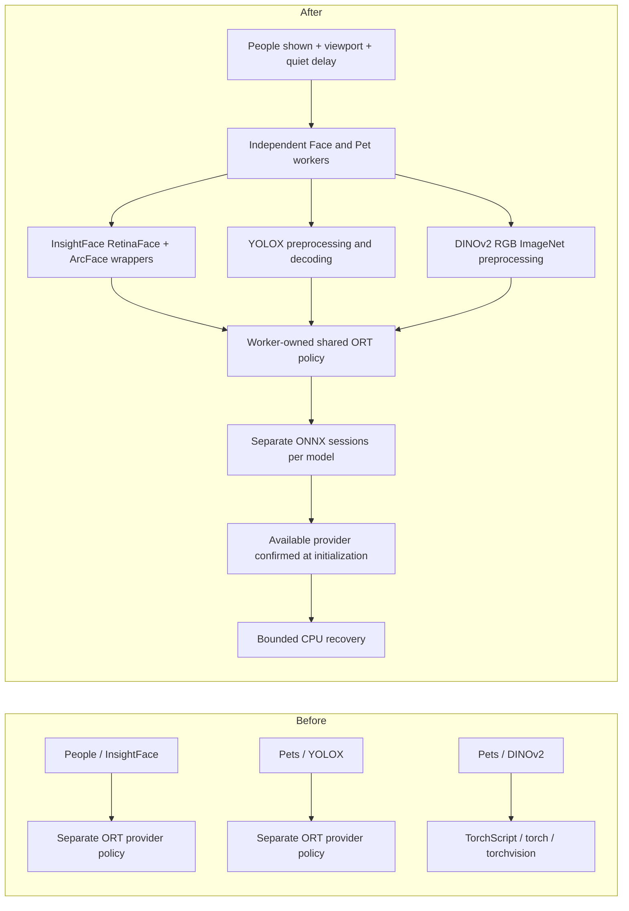
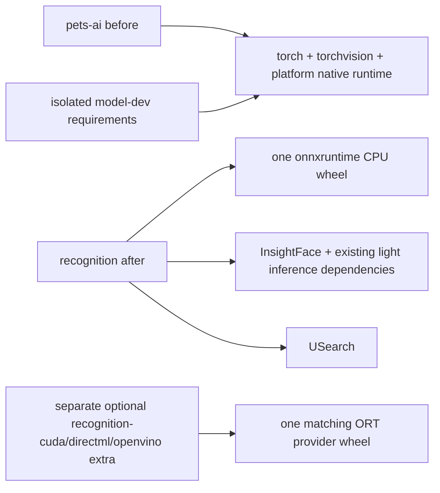

# Unified ONNX Runtime: implementation and release validation

Status: source implementation and verified published v2 model assets available;
native distribution acceptance remains open. **macOS Nuitka
compilation, App Bundle generation, release signing, final application size and
packaged execution: Pending Manual Validation.** No real Nuitka compilation or
full application build was run for this change. Small native fixtures in
Packaging Contract Tests are not release artifacts.

## Audit and runtime ownership

Audited the active RuntimeContext/LibrarySession composition, recognition gate,
scan workers, model lookup, installers, manifests, generation assignment and
activation, state repositories, mutation lease/journal, and all maintained
packaging drivers. Historical Pets designs and session/state migration records
are evidence only; current architecture contracts remain authoritative.



`recognition/onnx_runtime.py` owns provider candidates, session options,
diagnostics and recovery. It imports ORT only when inference is requested.
No global native sessions or parallel recognition services were added.
Each worker releases its pipeline in `finally`, including cancellation, missing
models, failed batches and library switching. Existing task priority, small
batches, backoff and admission gate remain unchanged. Two concurrent workers
have at most two compute threads each, fewer on small CPUs; session pools do
not spin while idle. DirectML uses sequential execution, disabled memory
patterns and serialized calls per session, following the
[ORT DirectML contract](https://onnxruntime.ai/docs/execution-providers/DirectML-ExecutionProvider.html).

InsightFace remains the detector/alignment/recognition wrapper. Its original
router rules select the two required tasks; models receive managed sessions.
`prepare(ctx_id=0)` prevents upstream from replacing injected CPU/CoreML/DML
sessions. Mask-renderer and typing compatibility shims remain intact.

No clustering parameters, candidate filters, People-overlap rules, index
algorithms, detection keys, database schemas or mutation semantics changed.
`assign_embedding_generation()` / `activate_embedding_generation()` retain
`dinov2-vits14-imagenet-normalized-v1`. No recognition database or user identity
was deleted or reset.

## Model identity and equivalence

The export input was the exact DINOv2 TorchScript member of the existing v1
combined ZIP, with SHA-256
`36e01591cfd52d194845d5b23b870dcb698f79c33f6140144180568f2155ab94`
and 88,587,286 bytes. Source revision remains
`7764ea0f912e53c92e82eb78a2a1631e92725fc8`.

The exported model is FP32 opset 17, input `image`, float32 RGB NCHW
`[1,3,224,224]`, output `embedding`, float32 `[1,384]`. It preserves the original
weights and output layer, `ImageOps.fit` BICUBIC, ImageNet normalization and L2
normalization. Its provenance metadata, file size, SHA-256, names, shapes,
dtypes, finite outputs and nonzero finite norm are verified before indexing.

| Actual generated asset | Bytes | SHA-256 |
| --- | ---: | --- |
| `dinov2_vits14.onnx` | 88,314,078 | `51f35f4a30a06dfa789eef2df2dcb82ecf0d8b071a3b88ce32dc9686819f452e` |
| `iphotron-recognition-models-v2.zip` | 100,318,770 | `a8ac03fb0b60b44c6187defadf3311c08440a7a306cc4b9bee10b0f1cb2b8d5c` |

Actual local assets are in `dist/onnx-migration/` (ignored by Git), with the
complete model whitelist under `dist/onnx-migration/models/`. The ZIP contains
exactly the two People models, YOLOX, DINOv2 ONNX, DINOv2 metadata and its file
manifest. `recognition/recognition_package.json` records every file identity.
Re-exporting with the pinned tooling reproduced the exact ONNX identity.

[Measured DINOv2 equivalence](evidence/onnx-runtime/dinov2-equivalence.json):
12 inputs, including public dog/cat images, mirror/brightness/crop variants,
black/white and seeded inputs; ONNX checker and real CPU ORT passed. Minimum
normalized embedding cosine was `0.9999999605882302`, raw max absolute error
`5.1021575927734375e-05`, normalized max error `1.1324882507324219e-06`, and
pairwise-distance max error `1.0728836059570312e-06`. The existing bounded
single-link algorithm made identical decisions at 134 thresholds, including
0.42 and 0.63 and observed distances ±1e-5. This evidence supports keeping the
embedding version; it is not an exhaustive claim about arbitrary exact-boundary
floating-point cases or a replacement for historical-library acceptance.

[Measured People equivalence](evidence/onnx-runtime/people-equivalence.json):
the public astronaut fixture produced one face; detector/NMS boxes, landmarks,
alignment-driven raw embedding were identical to the existing InsightFace CPU
wrapper. No wrapper algorithm was reimplemented.

## Export, model ZIP and publication

Keep this environment separate from every application/build venv:

```bash
python3.12 -m venv .venv-model-export
.venv-model-export/bin/python -m pip install -r tools/model-dev/requirements.txt
.venv-model-export/bin/python tools/fetch_dinov2_export_source.py --output dist/model-source/dinov2_vits14.pt
.venv-model-export/bin/python tools/export_dinov2_onnx.py \
  --torchscript dist/model-source/dinov2_vits14.pt \
  --output dist/onnx-migration/models/pets/embedding/dinov2_vits14/dinov2_vits14.onnx \
  --image /path/to/public-or-disposable-cat.jpg \
  --image /path/to/public-or-disposable-dog.jpg \
  --reference-output dist/onnx-migration/models/pets/embedding/dinov2_vits14/torchscript-reference.npz \
  --report dist/onnx-migration/equivalence.json
```

The export fetcher verifies the original v1 ZIP and member before loading it.
Normal export requires the checked-in ONNX identity. `--update-manifest` is an
explicit release-development operation requiring new equivalence review and
rebuilding the ZIP contract, not an end-user upgrade path. The former
`convert_dinov2_torchscript.py` production-generation tool was removed.

Copy the two verified People files and YOLOX from a known v1 installation into
the same staging root without modifying the original installation. Build:

```bash
.venv-model-export/bin/python tools/build_recognition_models.py \
  --model-root dist/onnx-migration/models \
  --output dist/onnx-migration/iphotron-recognition-models-v2.zip \
  --contract src/iPhoto/recognition/recognition_package.json \
  --published-url 'https://github.com/OliverZhaohaibin/iPhotron-LocalPhotoAlbumManager/releases/download/People%26Pets-models-v2/iphotron-recognition-models-v2.zip'
```

The [v2 Release](https://github.com/OliverZhaohaibin/iPhotron-LocalPhotoAlbumManager/releases/tag/People%26Pets-models-v2)
is published. Its ZIP attachment was actually downloaded over HTTPS and matched
the measured 100,318,770-byte size and SHA-256 recorded above. The release
contract now contains the direct ZIP URL and `release_status: published`.
For future releases, upload a new attachment, keep the v1 ZIP available for old
clients, then run the builder with that actual `--published-url`. It verifies
the remote bytes before writing the contract. The independent DINOv2 `onnx_url`
remains null because the combined ZIP provisions the complete model set.

Settings and recovery offer application download, browser download and offline
installation. Automatic acquisition retains the existing recognition activation
gate and one-attempt limit. Models install atomically under
`extensions/recognition/v2/models`, with existing locks, same-volume staging,
backup recovery, cancellation and safe extraction. v1 is never overwritten.
People searches intact v1 ONNX files and backup after v2; Pets ignores `.pt`.
An interrupted/failed v2 upgrade cannot remove usable v1 People models or any
library-owned state.

## Providers and dependency closure

| Platform | Default wheel and CPU baseline | Optional acceleration | Actual validation here |
| --- | --- | --- | --- |
| Windows x64 | `onnxruntime`, CPU | Exclusive DirectML or CUDA build | Policy/native contracts; real OS/device run pending |
| macOS Apple Silicon | `onnxruntime` 1.25.1, CPU | Explicit CoreML selection if advertised and initialized | Real CPU passed; source CoreML cosine ≥0.9999757 on cat/dog; sandbox cache failure recovered to CPU |
| macOS Intel | `onnxruntime` 1.23.2, CPU, Python 3.12/3.13 | CoreML only if its wheel/device supports it | Source/packaging contracts; real Intel run pending |
| Linux | `onnxruntime`, CPU | Exclusive CUDA or OpenVINO build | Policy/packaging contracts; real OS/device run pending |

CUDA sessions disable TF32 to preserve FP32 computation. OpenVINO keeps one
stream, FP32 precision and the worker CPU budget;
`IPHOTO_RECOGNITION_OPENVINO_DEVICE=GPU` explicitly selects an installed Intel GPU.
These settings follow the official [CUDA](https://onnxruntime.ai/docs/execution-providers/CUDA-ExecutionProvider.html)
and [OpenVINO](https://onnxruntime.ai/docs/execution-providers/OpenVINO-ExecutionProvider.html) options; actual device validation remains pending.

macOS CPU is the default even when its CPU wheel also advertises CoreML.
The controlled source CoreML run registered CoreML+CPU and passed the initial
cosine gate on public cat/dog inputs (minimum `0.9999757203589921`), but its two
inference samples took 51.09/33.24 ms versus CPU's ~18 ms median. Availability
therefore does not qualify it as a faster default. Enable it explicitly with
`IPHOTO_RECOGNITION_PROVIDERS=CoreMLExecutionProvider,CPUExecutionProvider`.
The [CoreML numeric probe](evidence/onnx-runtime/coreml-equivalence.json) ran
outside the restricted execution sandbox. A separate
[sandbox failure probe](evidence/onnx-runtime/provider-probe.json) demonstrated
bounded CPU recovery for all four models. Neither proves every operator used
the GPU, full-library compatibility or packaged acceptance.

The standard CPU wheel is not assumed to contain CUDA/DirectML/OpenVINO.
Candidates come from actual availability, then session initialization confirms
them; actual providers and fallback reasons are logged. Recognized native/device
errors allow one CPU retry. Corrupt models, invalid graph/shape/type and general
business errors are not swallowed. `IPHOTO_RECOGNITION_PROVIDERS` can select an
explicit ordered list; `CPUExecutionProvider` forces CPU.

[Resolved production dependency closure](evidence/onnx-runtime/production-dependency-closure.json)
contains 88 distributions on this macOS arm64 resolver run and no Torch,
TorchVision, TorchAudio, Triton or NVIDIA package. This is resolution evidence,
not an installed full-build acceptance claim. A fresh minimal source inference
venv was actually installed without Torch and ran both real models. Its
[installed inventory](evidence/onnx-runtime/clean-runtime-environment.json) is separate.



Use exactly one of `recognition`, `recognition-cuda`, `recognition-directml`,
`recognition-openvino` in separate build environments. Do not combine a GPU
extra with `ai-demo`, `pets-ai` or `recognition`, which require the CPU wheel.
CUDA/cuDNN can be supplied by the optional build/system configuration; they are
never installed by the default CPU extra. Optional device/native dependency
versions and package size must be recorded separately when actually tested.
Intel macOS compatibility retains the published
[ORT 1.23.2 x86-64 Python wheel](https://pypi.org/project/onnxruntime/1.23.2/).
CoreML is conditional on its
[provider and OS capabilities](https://onnxruntime.ai/docs/execution-providers/CoreML-ExecutionProvider.html).

All three primary drivers preflight a Torch-free exclusive ORT environment,
include ORT/USearch, and reject forbidden outputs instead of deleting necessary
native libraries. ORT's Nuitka rule collects provider binaries; the additional
package rule retains optional DirectML. Windows keeps DLL-directory handles
for the worker lifetime. Linux preserves Nuitka RPATH/standalone layout and the
Flatpak ELF gate. macOS repairs collected ORT dylib references to bundle-local
paths and signs them before sealing the app. The old torch-header pruning
workaround is removed. Maps, Qt, FFmpeg, OpenCV, RAW, Live Photo, USearch and AOT
filters keep their existing build path.

## macOS full build command — Pending Manual Validation

Run manually from the repository root, on each target architecture. No command
in this block was used to build an application during this task:

```bash
python3.12 -m venv .venv-build-recognition
.venv-build-recognition/bin/python -m pip install --upgrade pip setuptools wheel
.venv-build-recognition/bin/python -m pip install -c packaging/recognition-cpu-constraints.txt numpy Cython
.venv-build-recognition/bin/python -m pip install --no-build-isolation \
  -c packaging/recognition-cpu-constraints.txt -e '.[recognition]' \
  nuitka ordered-set zstandard imageio
.venv-build-recognition/bin/python tools/recognition_packaging.py environment --require-complete \
  --output dist/macos-onnx-build-dependencies.json
bash scripts/build_nuitka_macos.sh \
  --python "$PWD/.venv-build-recognition/bin/python" \
  --output-dir "$PWD/dist/macos-onnx" \
  --sdk-root "$PWD/../PySide6-OsmAnd-SDK" \
  --qt-root /opt/homebrew/opt/qt \
  --jobs 4 \
  --recognition-model-dir "$PWD/dist/onnx-migration/models"
```

This command uses existing LTO=yes, builds AOT filters and the SDK runtime,
synchronizes Maps, builds the App Bundle, repairs/signs native code and records
reports. On Intel use the installed Intel Qt root (commonly
`/usr/local/opt/qt`) for `--qt-root`. To ship models separately, omit only
`--recognition-model-dir`; do not omit the runtime. Do not use `--low-memory`
for an A/B size comparison because it changes the LTO profile.

Manual acceptance, each recorded with revision, OS/CPU, ORT version, wheel,
actual providers, model ZIP hash and artifact hash:

1. Verify generated `nuitka-compilation-report.xml`,
   `recognition-dependencies.json`, `recognition-artifact.json` and
   `build-manifest.json`; inspect the largest files and all native dependencies.
   Confirm no libtorch/torch_cpu/torch_cuda/torchvision/Triton or default CUDA
   payload. Keep model staging, Qt plugins, Maps resources and LTO identical for
   the baseline and candidate. The 450–600 MB target is a goal, not a measured
   result or reason to remove required components.
2. Verify `otool -L` on the ORT binding/provider libraries has only bundle-local
   or system dependencies. Run `codesign --verify --deep --strict --verbose=2
   dist/macos-onnx/entrypoint.app`. Complete the project's Developer ID signing,
   notarization and Gatekeeper release checks; the script's ad-hoc signature is
   not Developer ID release acceptance.
3. Launch the app without a Python venv or model-development environment.
   Before opening People, confirm no model initialization at startup or metadata
   scan. Show People, wait for viewport and quiet delay, then recognize public
   face/cat/dog photos. Test CPU, available CoreML and recognized device-failure
   fallback. Confirm normal Gallery, Detail/Edit, RAW, Live Photo/video and Maps.
4. On a disposable copy of a historical library, compare names, covers, hidden
   state, card/group order, manual faces, rejected detections, redirects and merge
   results before/after scanning. Retain unfinished journal work and test restart
   recovery. Confirm no embedding-generation change or full rescan just from
   switching this compatible runtime.
5. Test empty caches, valid v1 People reuse, offline v2 import, wrong hash,
   truncated/unsafe ZIP, cancelled promotion and recovered backup. Pending/retry
   work survives; one missing worker does not stop the other. Test switching
   libraries and quitting during load/inference/download, with no late callback
   or retained old native session.
6. Measure final standalone/app and compressed release bytes using the same
   release compression/signing procedure. Record actual cold app start, first
   model initialization, inference latency, full-library scan throughput, CPU/GPU
   usage and peak RSS on dedicated benchmark libraries. Keep optional GPU
   artifacts separate. Record results here before marking any packaged item
   passed.

Windows and Linux full native release runs, GUI/device performance and final
sizes are also pending on their target hosts; policy or fixture tests do not
establish those outcomes.

## Actual source measurements and verification

[Source DINOv2 microbenchmark](evidence/onnx-runtime/source-benchmark.json),
macOS arm64, two compute threads, 50 iterations on the same public cat/dog
inputs, one fresh subprocess per runtime:

| Measurement | Original TorchScript CPU | ONNX CPU |
| --- | ---: | ---: |
| Model initialization including runtime import | 536.4 ms | 205.7 ms |
| First inference | 66.4 ms | 19.0 ms |
| Median inference | 22.06 ms | 17.64 ms |
| p95 inference | 28.30 ms | 18.25 ms |
| Repeated model throughput | 44.08/s | 56.43/s |
| Peak process RSS | 350,011,392 B | 195,510,272 B |

These are actual source component measurements from one local run; they do not
measure application startup, end-to-end scan throughput, GPU utilization or a
frozen executable. No unmeasured cross-platform speed claim is made.

Commands actually run and final result ledger are recorded in
[verification results](evidence/onnx-runtime/verification.md). CI now exports
and checks the exact model once in an isolated development job, then validates
CPU inference and legacy embeddings without Torch on Linux, Windows, Apple
Silicon and Intel macOS. Existing official YOLOX and Pets 50k/384-dimensional
jobs remain. New workflow execution on remote runners is pending.
